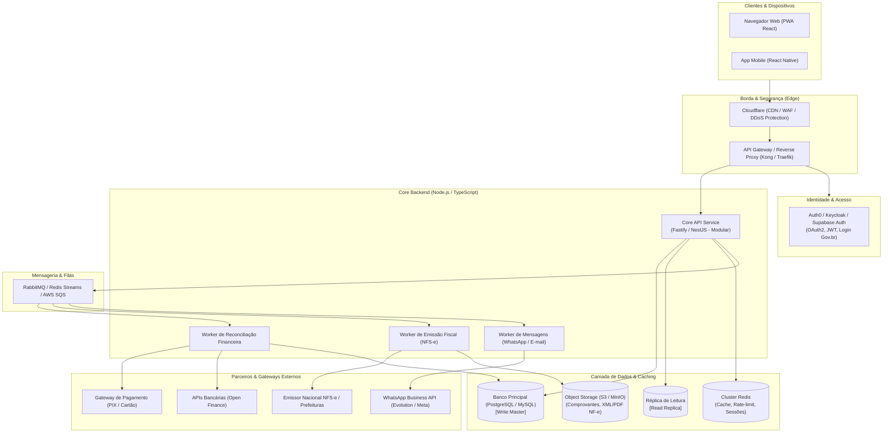
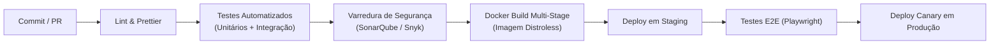

# Plano Estratégico de Escalabilidade — Plataforma Arandu Gestão

> **Documento de Engenharia de Software e Arquitetura de Sistemas**  
> **Versão:** 1.0.0  
> **Alinhamento:** ODS 1 (Erradicação da Pobreza) & Inclusão Financeira para Microempreendedores (MEIs)

---

## Sumário Executivo

O **Arandu Gestão** nasceu como um sistema de gestão financeira e operacional simples, intuitivo e focado nas necessidades reais de microempreendedores individuais no Brasil. Após a consolidação do MVP funcional (com controle de estoque, reconciliação de caixa e catálogo de produtos/serviços), o objetivo deste documento é traçar o **plano técnico e arquitetural para transformar o protótipo em uma plataforma SaaS (Software as a Service) resiliente, segura e capaz de atender de 1 a 100.000 MEIs ativos**.

---

## 1. Diagnóstico Atual vs. Visão de Escala

| Dimensão | Estado Atual (MVP) | Estado Alvo (Escala / Produção SaaS) |
|---|---|---|
| **Modelo de Usuário** | Monousuário local (sem autenticação) | Multi-tenant isolado por empresa/MEI com RBAC |
| **Arquitetura** | Monólito Express + SPA React | Monólito Modular evoluindo para Serviços Orientados a Eventos |
| **Banco de Dados** | MySQL 8.4 único com dados locais | PostgreSQL / MySQL com Read-Replicas, Particionamento e RLS |
| **Processamento** | Totalmente síncrono no backend | Assíncrono com Filas (RabbitMQ / SQS / Redis Streams) |
| **Pagamentos** | Registro manual | PIX Dinâmico, Boleto e Cartão via Webhooks automáticos |
| **Fiscal** | Sem suporte fiscal | Emissão automática de NFS-e (Padrão Nacional) e NFC-e |
| **Infraestrutura** | Docker Compose local | Kubernetes (EKS/GKE) ou Container Apps com autoscaling |
| **Observabilidade** | Logs de console (`console.log`) | OpenTelemetry, Prometheus, Grafana, Sentry e ELK/Loki |
| **Confiabilidade** | Sem testes automatizados | Suíte completa: Unitários, Integração e E2E (Vitest + Playwright) |

---

## 2. Arquitetura Alvo (Target Architecture)



---

## 3. Segurança, Multi-Tenancy e Isolamento de Dados

Para suportar múltiplos clientes mantendo o custo controlado e o isolamento de informações rigoroso:

### 3.1. Estratégia de Multi-Tenancy: Banco Compartilhado com RLS
- **Modelo adotado:** *Shared Database, Shared Schema com `tenant_id` obrigatório*.
- Todas as tabelas (`customers`, `products`, `orders`, `expenses`, `bank_accounts`, `cash_transactions`) receberão a coluna:
  ```sql
  tenant_id UUID NOT NULL REFERENCES tenants(id) ON DELETE CASCADE
  ```
- **Row-Level Security (RLS):** No PostgreSQL ou MySQL 8+, políticas de RLS garantem no nível do próprio banco que uma consulta nunca retorne registros pertencentes a outro empreendedor, mesmo em caso de falha de filtro na camada de aplicação.
- No backend, todo request autenticado define o contexto de tenant na sessão:
  ```sql
  SET LOCAL app.current_tenant_id = 'tenant-uuid-aqui';
  ```

### 3.2. Autenticação Moderna e Acessível para o MEI
- **Padrão:** OAuth 2.0 + OpenID Connect com JSON Web Tokens (JWT).
- **Estratégia de Tokens:**
  - `access_token` de curta duração (15 minutos), assinado assimetricamente via RS256.
  - `refresh_token` de longa duração (30 dias) armazenado em Cookie seguro `HttpOnly`, `SameSite=Strict`, `Secure`.
- **Inclusão Digital Facilitada:**
  - Login Social integrado com Google e **Gov.br** (essencial para MEIs brasileiros que já utilizam a conta Gov para emitir o DAS e notas fiscais).
  - Autenticação sem senha (Magic Link via WhatsApp ou E-mail) para reduzir atrito de acesso.

### 3.3. Conformidade com a LGPD (Lei Geral de Proteção de Dados)
- Criptografia em trânsito com TLS 1.3 obrigatório e HSTS ativado.
- Criptografia em repouso (AES-256) em volumes de banco de dados e backups.
- Trilha de auditoria (`audit_logs`) gravando quem acessou, modificou ou deletou informações cadastrais e financeiras.
- Endpoint de exclusão e anonimização de dados a pedido do titular (Direito ao Esquecimento).

---

## 4. Automações de Negócio de Alto Impacto para MEIs

O grande diferencial do Arandu Gestão para escalar sua base é resolver burocracias diárias do microempreendedor:

### 4.1. PIX Cobrança Automático (Baixa Instantânea)
1. Ao fechar o pedido, o Arandu Gestão gera um **QR Code PIX Dinâmico** com valor exato, expiração e identificador único `txid`.
2. O cliente do MEI paga pelo app do banco dele.
3. O gateway bancário (ex: Asaas, Mercado Pago, Efí) envia um **Webhook** para o Arandu Gestão.
4. O worker processa o webhook com idempotência, marca o pedido como `paid`, estorna o estoque se necessário e gera o crédito na conta bancária correspondente em menos de 2 segundos.

### 4.2. Emissão Simplificada de NFS-e Nacional
- Integração com o novo padrão da **NFS-e Nacional do MEI** (Resolução CGSN nº 169).
- Emissão em um clique diretamente pela tela do pedido, gerando o PDF do DANFSE e o XML arquivado no S3.

### 4.3. Régua de Cobrança Inteligente via WhatsApp
- Para pedidos pendentes ou despesas a receber de clientes fiados:
  - Envio de lembrete cordial no dia do vencimento com link direto para o PIX.
  - Redução de até 40% na inadimplência de pequenos negócios locais.

### 4.4. Conciliação Bancária via Open Finance
- Conexão via consentimento seguro do MEI para ler extratos bancários de bancos como Nubank, Inter, Caixa, Itaú e Bradesco.
- Cruzamento automático das saídas da conta com as despesas cadastradas no Arandu Gestão.

---

## 5. Estratégia de Banco de Dados, Caching e Performance

### 5.1. Otimização de Índices Relacionais
Para garantir consultas de dashboard com tempo de resposta `< 50ms` mesmo com milhões de transações:

```sql
-- Índices essenciais para consultas multi-tenant frequentes
CREATE INDEX idx_orders_tenant_date_status ON orders(tenant_id, order_date DESC, status);
CREATE INDEX idx_expenses_tenant_date_status ON expenses(tenant_id, expense_date DESC, status);
CREATE INDEX idx_transactions_tenant_date ON cash_transactions(tenant_id, transaction_date DESC);
CREATE INDEX idx_order_items_product ON order_items(product_id);
```

### 5.2. Camada de Cache Distribuído (Redis)
- **Padrão Cache-Aside:**
  - Métricas do Dashboard: Chave `dashboard:{tenant_id}:{month_year}` invalidada apenas em eventos de nova venda, despesa ou transação.
  - Catálogo de Produtos e Clientes com cache TTL de 1 hora.
- **Distributed Locking:** Uso do `Redlock` para evitar concorrência em baixa simultânea de estoque do mesmo produto.

---

## 6. Pipeline de CI/CD, Testes e Qualidade de Código

Para garantir lançamentos seguros sem quebrar o ambiente de produção:



### Pirâmide de Testes Recomendada
1. **Testes Unitários (Vitest):** Cobertura das regras de negócio (cálculo de descontos, validação de payloads, formatação monetária).
2. **Testes de Integração (Supertest + Testcontainers):** Testar cada endpoint da API levantando um banco MySQL/PostgreSQL descartável em container Docker.
3. **Testes E2E (Playwright):** Testar o fluxo completo do usuário no navegador: login -> criar produto -> criar pedido -> conferir se o dashboard atualizou.

---

## 7. Observabilidade, Métricas e Confiabilidade (SRE)

Para operar com padrão de alta confiabilidade:

- **SLO (Service Level Objective):**
  - **Disponibilidade:** 99.9% de uptime mensal.
  - **Latência:** 95% das requisições respondidas em menos de 200ms.
- **Stack de Monitoramento:**
  - **Sentry:** Captura de exceções não tratadas no frontend e backend em tempo real com stack trace completo.
  - **Prometheus + Grafana:** Monitoramento de uso de CPU, memória, tempo de resposta HTTP, saturação do pool de conexões do banco de dados e tamanho de filas.
  - **Alertmanager:** Alertas críticos no canal do Slack/Telegram do time de desenvolvimento caso a taxa de erro HTTP 5xx passe de 1%.

---

## 8. Estimativa de Custos de Infraestrutura por Patamar

| Faixa de Usuários | Stack Recomendada | Custo Estimado / Mês |
|---|---|---|
| **0 a 1.000 MEIs** | - 1x VPS robusta (Hetzner ou DigitalOcean) ou Render/Fly.io<br>- PostgreSQL gerenciado básico<br>- Redis compartilhado<br>- S3 Cloudflare R2 (sem custo de saída) | **\$30 – \$60 USD** |
| **1.000 a 10.000 MEIs** | - AWS ECS Fargate / GCP Cloud Run (autoscaling)<br>- AWS Aurora PostgreSQL Serverless v2 (com read-replica)<br>- AWS ElastiCache Redis<br>- SQS para mensageria | **\$250 – \$600 USD** |
| **10.000 a 100.000 MEIs** | - Cluster Kubernetes (EKS/GKE) com horizontal pod autoscaler<br>- Multi-AZ Aurora PostgreSQL com sharding lógico<br>- Cluster Redis de alta disponibilidade<br>- Cloudflare Enterprise / AWS WAF | **\$1.800 – \$4.000 USD** |

*Nota: Considerando uma precificação de SaaS acessível (ex: plano básico gratuito e plano Pro por R$ 29,90/mês), a plataforma atinge ponto de equilíbrio (breakeven) financeiro com facilidade já nos primeiros 200 assinantes pagantes.*

---

## 9. Roadmap de Execução por Trimestres

```text
2027
 ├── Q1: Fundação Multi-Tenant & Segurança
 │    ├── Migração do backend para TypeScript
 │    ├── Implementação do modelo multi-tenant com tenant_id e RLS
 │    ├── Camada de autenticação JWT + Login Social (Google / Gov.br)
 │    └── Suíte de testes unitários e de integração no CI/CD
 │
 ├── Q2: Serviços Financeiros & Pagamentos
 │    ├── Integração com gateway PIX com baixa automática via Webhook
 │    ├── Emissão de recibos, comprovantes e orçamentos em PDF
 │    ├── Módulo de relatórios exportáveis em Excel/CSV
 │    └── Lançamento do PWA instalável no celular
 │
 ├── Q3: Automação Fiscal & Mensageria
 │    ├── Integração com emissor oficial da NFS-e Nacional
 │    ├── Robô de lembrete e cobrança amigável via WhatsApp
 │    ├── Painel de controle de metas financeiras do MEI
 │    └── Testes de carga e stress (k6) para validar 5.000 req/s
 │
 └── Q4: Escala, IA e Open Finance
      ├── Conexão bancária automática via Open Finance
      ├── Assistente financeiro com IA para sugestão de precificação e compras
      ├── Programa de parcerias com cooperativas de crédito e microcrédito
      └── Infraestrutura Kubernetes multi-região com alta disponibilidade
```

---

## Conclusão

O projeto Arandu Gestão já possui alicerces sólidos: arquitetura clara, proposta de valor humanizada alinhada com o ODS 1 e código limpo. A execução do plano de escalabilidade acima garantirá que a plataforma evolua de um protótipo acadêmico para uma ferramenta comercial de impacto real na sobrevivência e prosperidade de milhares de microempreendedores pelo Brasil.

